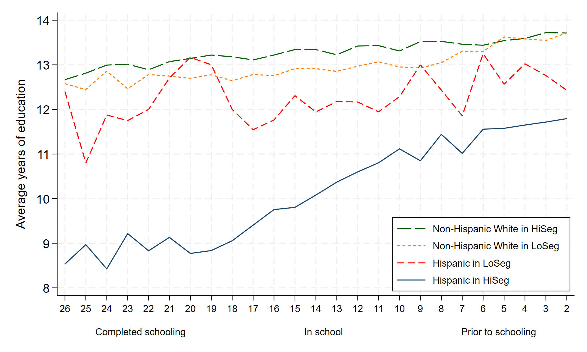
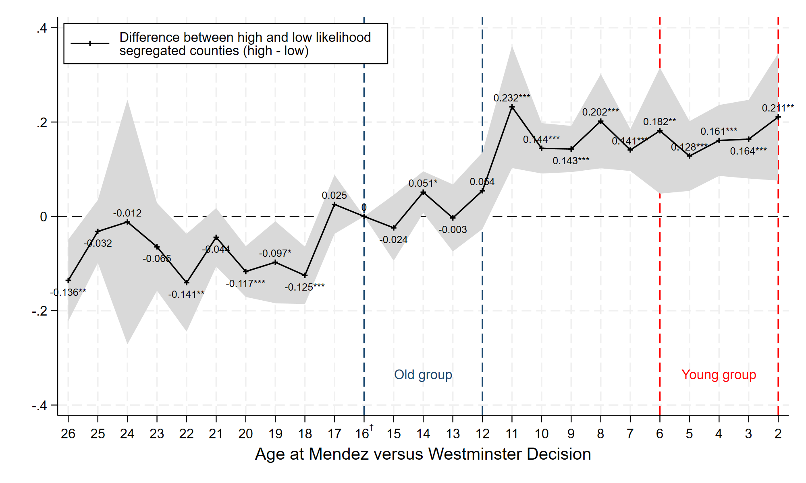

# Antman_Cortes_Repl

Independent replication of Antman and Cortes (2023), "The Long-Run Impacts of Mexican American School Desegregation," *Journal of Economic Literature* 61(3): 888–905.

Antman and Cortes (2023) examine long-run educational attainment for Hispanics and non-Hispanic Whites in California after the 1947 *Mendez v. Westminster* court decision ended de jure segregation of Mexican American schoolchildren. They use a difference-in-differences design across high and low segregation counties. One command regenerates every number and figure: `cd` to the repo root, `do run.do`.

## What is replicated

- [x] Figure 1: average years of education by cohort, Hispanic and non-Hispanic White, high- vs low-segregation counties
- [x] Table 1: group means and standard deviations, within-cohort gaps, and the 2×2 difference-in-differences
- [x] Table 2 Panel A: equation (1) with county and birth-year fixed effects, Hispanic sample
- [x] Table 2 Panel B: placebo cohorts (born 1926–30 vs 1921–25)
- [x] Table 2 Panel C: non-Hispanic White sample
- [x] Figure 2: event study, junior high school completion
- [x] Appendix: event studies for years of education and high school completion, plus the full coefficient table





## Data

The analysis uses an IPUMS USA extract. The extract is not redistributed here. IPUMS terms of use prohibit it, so `data/raw/data-CA.dta` is not included.

Antman and Cortes (2023, p. 892) use IPUMS 5 percent public use samples of the 1980, 1990, and 2000 US decennial censuses. The sample consists only of people born in California.

To rebuild the extract, request the following from [IPUMS USA](https://usa.ipums.org/usa/) and save it as `data/raw/data-CA.dta`. This matches `data/raw/codebook.txt`, which is included:

| Item | Value |
|---|---|
| Samples | 1980 5%, 1990 5%, 2000 5% |
| Case selection | STATEFIP = 06 (California) |
| File type | Rectangular (person) |
| Format | Stata `.dta` |

Variables: `YEAR SAMPLE SERIAL HHWT CLUSTER STATEFIP COUNTYFIP STRATA GQ PERNUM PERWT SEX BIRTHYR RACE RACED HISPAN HISPAND BPL BPLD CITIZEN EDUC EDUCD`

## How to run

Requirements: Stata 16 or newer. Nothing needs to be installed: `estout` (Ben Jann, MIT license) is vendored in `code/ado/estout/` and loaded by `run.do` via `adopath`. The pipeline runs offline and never calls `ssc install`.

In Stata, set the working directory to the repository root and run the master file:

```stata
cd "/path/to/Antman_Cortes_Repl"
do run.do
```

Or from a shell:

```bash
stata -b do run.do
```

`run.do` regenerates everything: the cleaned data set, all figures, all tables, and a log per step. Runtime: ~1 minute. To rerun a single step, set `global only "04"` before `do run.do`.

Outputs:

| Path | Contents |
|---|---|
| `output/figures/` | Figures 1, 2, A1, A2 as `.png` and `.pdf` |
| `output/tables/` | LaTeX fragments and CSV twins for every table |
| `output/logs/` | One log per do-file (local paths and timestamps replaced) |
| `run.log` | Master log, including the Stata version used (local paths and timestamps replaced) |

## Repository structure

```
run.do                    master; sets paths, runs code/01-06 in order
code/01_build_data.do     IPUMS extract  -> data/clean/antman_cortes_clean.dta
code/02_figure1.do        cohort means   -> output/figures/fig1_*
code/03_table1.do         Table 1        -> output/tables/table1_summary.*
code/04_table2.do         Table 2 A/B/C  -> output/tables/table2_panel*.*
code/05_event_study.do    Figures 2/A1/A2 and output/tables/eventstudy_coefs.*
code/06_prose_numbers.do  numbers cited in the write-up -> output/tables/prose_numbers.*
code/lib/yrsed.do         EDUCD -> years of schooling crosswalk
code/ado/estout/          vendored estout package (MIT)
data/raw/                 the IPUMS extract (not included) and its codebook
data/clean/               generated analysis file (created by run.do)
output/{figures,tables,logs}
paper/replication.tex     write-up; \input tables, \includegraphics figures
paper/replication.pdf     compiled write-up
paper/references.bib      bibliography
```

## Results at a glance

Sample sizes are exact and point estimates differ only slightly, consistent with IPUMS revisions. The event-study extension adds the same pattern for years of education and a weaker one for high school.

## Write-up

See [`paper/replication.pdf`](paper/replication.pdf).

## References

Antman, Francisca M., and Kalena E. Cortes. 2023. "The Long-Run Impacts of Mexican American School Desegregation." *Journal of Economic Literature* 61(3): 888–905. https://doi.org/10.1257/jel.20221704

Ruggles, Steven, Sarah Flood, Matthew Sobek, Daniel Backman, Annie Chen, Grace Cooper, Stephanie Richards, Renae Rogers, and Megan Schouweiler. *IPUMS USA: Version 15.0* [dataset]. Minneapolis, MN: IPUMS, 2024. https://doi.org/10.18128/D010.V15.0
